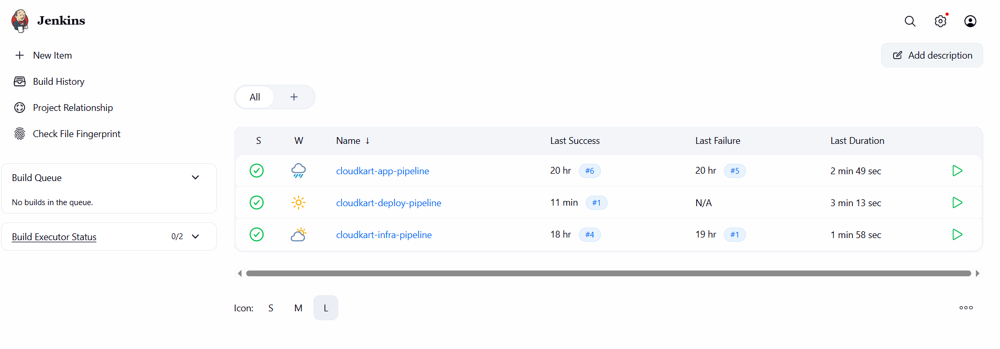
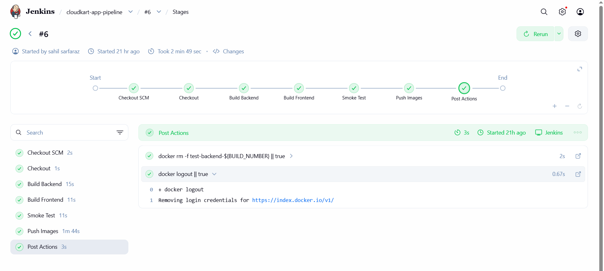
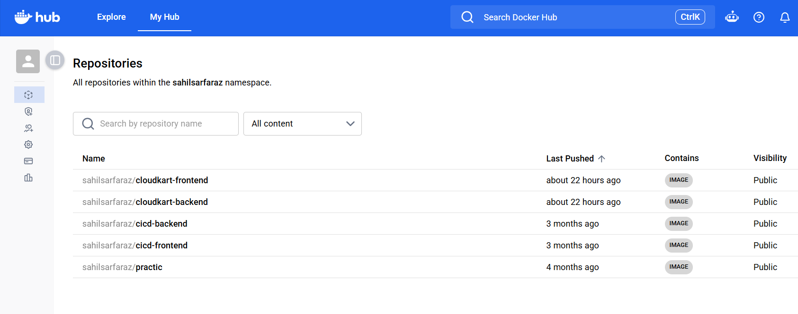

# CloudKart App

The application layer of the CloudKart Platform: a Node.js/Express backend and an nginx frontend, each in its own Docker image and built by a Jenkins pipeline.

## What it does
- Backend exposes `/` and `/health` on port 3000.
- Frontend is a static page that calls the backend health endpoint.

## CI pipeline (Jenkins)
- Checkout
- Build backend image
- Build frontend image
- Smoke test (start the backend container and call /health)
- Push both images to Docker Hub, tagged with the Jenkins build number

Docker Hub credentials are stored in Jenkins credentials. No secrets are kept in this repo.

## Tech
Docker, Jenkins (declarative pipeline), Node.js, nginx, Docker Hub

## Screenshots

## Related repos
- cloudkart-infra: Terraform and the infrastructure pipeline
- cloudkart-deploy: Kubernetes manifests and the deploy pipeline
